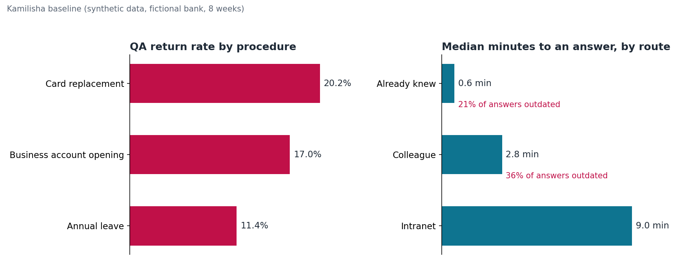

# Stage 4 — Baseline

**Question:** How slow and error-prone is the work today, and what is a fix worth?

## Summary

Synthetic "today" data for a fictional bank: four branches (two pilot, two comparison), eight weeks, 880 requests across the three pilot procedures.

- **One file in five comes back from QA:** 18.6% of files, 20.2% for card replacement.
- **The blocking form is on file for only 76.2% of card replacements.**
- **A lookup takes 4.9 minutes** (median) when the officer does not already know the answer.
- **Asking a colleague is fast but unreliable:** 36% of colleague answers were outdated.

**Benefits case (expected):** about 10,200 staff hours a year released, worth TZS 153M at staff cost, against year-one costs of TZS 108M. Most of the value is staff time, not cash. **Adoption is the biggest risk:** at 30% adoption, year one does not pay back, so the pilot must prove staff use it.

## Deliverables

| File | What it shows |
| --- | --- |
| [kpi-definitions.md](kpi-definitions.md) | 12 KPIs: business outcomes, adoption and quality, with definitions, sources and pilot targets |
| [baseline-summary.md](baseline-summary.md) | Baseline KPI values for all, pilot and comparison branches |
| [benefits-case.md](benefits-case.md) | Evidence, forecast benefits in three scenarios, costs, net view, sensitivity, and what is not counted |
| [assumptions-register.csv](assumptions-register.csv) | Every assumption with cautious, expected and optimistic values, basis and owner to confirm |
| [generate_baseline.py](generate_baseline.py) | Creates the synthetic data, summary and chart (seeded, so reruns match) |
| [benefits_model.py](benefits_model.py) | Calculates the benefits case from the data and the register |
| [data/](data/) | Request log, staff survey and audit queries |

## Key judgements

- **Evidence and forecast are kept apart.** Measured baseline values and forecast benefits sit in separate sections; training attendance and licence counts are never counted as benefit.
- **No double counting.** Fraud loss avoided is credited to the system hard stop for the blocking form (Stage 2, P4), not to Kamilisha.
- **Comparison branches from day one.** Benefit evidence in Stage 9 is the change in pilot branches minus the change in comparison branches.

## Handover to Stage 5

Stage 5 sets the guardrails that protect the targets: what the assistant must never do, who reviews its answers, and how problems are escalated.
