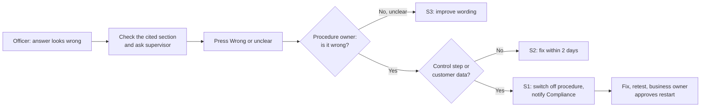

# Oversight and escalation

## Routine oversight

| Check | Who | How often | Uses |
| --- | --- | --- | --- |
| Sample review: 20 answers per procedure marked correct or not | Procedure owner | Weekly in the pilot, monthly after | K9 answer quality |
| "Wrong or unclear" queue cleared | Procedure owner | Within 2 working days (1 for control steps) | K10 |
| Declined questions (control workarounds) reviewed | Procedure owner and Compliance | Weekly | Training and control design |
| "Not found" list reviewed for library gaps | Data Management Office | Weekly | K11 |
| Quality reported separately for English and Swahili | Data Management Office | Weekly | Equal service in both languages |
| Governance report | Data Management Office to business owner | Monthly | All KPIs |

## When something goes wrong

| Severity | Example | Action | Time limit |
| --- | --- | --- | --- |
| S1 | Wrong answer on a control step; customer data exposed | Switch off that procedure (G-11), notify Compliance, fix and retest before restarting | Switch off within 1 hour |
| S2 | Wrong answer on a non-control step | Correct the library entry, retest the affected questions | 2 working days |
| S3 | Correct but unclear wording | Improve at the next library update | Next update |

## RACI

R = does the work, A = accountable, C = consulted, I = informed.

| Activity | Branch officer | Supervisor | Procedure owner | Data Management Office | Compliance | Business owner |
| --- | --- | --- | --- | --- | --- | --- |
| Act on an answer at the counter | R, A | C | | | | |
| Flag a wrong or unclear answer | R | R | I | I | | |
| Approve circular content for the library | | | R, A | C | C | |
| Load and retire circulars | | | A | R | | |
| Weekly answer review | | | R, A | C | I | |
| Switch off a procedure (S1) | | | C | R | C | A |
| Review declined workaround questions | | | R | C | A | I |
| Handle a customer-data incident | | I | | R | A | I |
| Monthly governance report | | | C | R | C | A |
| Approve go-live and restarts | | | C | R | C | A |
