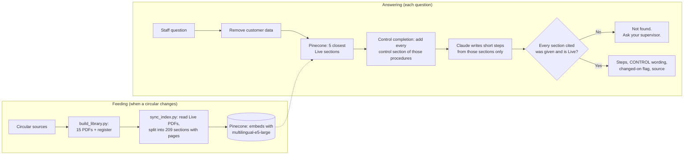

# Stage 6 — Prototype

**Question:** Can a working version answer from the current circulars, in plain English or Swahili, with citations, and keep to the guardrails?

A working assistant on a fictional library of **15 intranet-style PDFs (92 pages)**: 12 Mfano Bank procedures and policies across cards, onboarding, digital channels, lending and staff affairs, with old and current versions of the three demo procedures. It uses **retrieval-augmented generation (RAG)**: Pinecone finds the five most relevant sections of the Live circulars, and Claude Sonnet 5.5 answers from those sections only.

## How it works

**Why Pinecone:** it searches by meaning, so a Swahili question finds an English section. On 21 test questions, Pinecone found the answer in the top 5 for 13 of 13 English and 7 of 8 Swahili questions; the built-in keyword fallback found 13 of 13 English but 0 of 8 Swahili.

**Why control completion:** search ranks by similarity, not by importance, so a control step can miss the top 5. Whenever search returns any section of a procedure, Kamilisha also gives Claude every mandatory-control section of that procedure (guardrail G-13).

**The AI writes the steps; the library supplies everything that must be exact:** citations, version, page, control flags, the circular's own wording on control steps, and the "changed on" date.

## Run it

Follow the [feeding guide](feeding-guide.md) for the first run. In short, from this folder:

1. `pip install -r requirements.txt`
2. Copy `.env.example` to `.env` and add `ANTHROPIC_API_KEY` and `PINECONE_API_KEY`. The `.env` file is in `.gitignore`, so keys never go to GitHub.
3. `python app/sync_index.py` feeds the 12 Live circulars into Pinecone.
4. `python app/eval_retrieval.py` measures retrieval in English and Swahili.
5. `streamlit run app/app.py` starts the staff screen.

Each question costs a small amount of API credit (roughly one to three US cents with Claude Sonnet 5.5; check current [pricing](https://platform.claude.com/docs/en/about-claude/pricing)).

## Files

| Path | What it is |
| --- | --- |
| [library/](library/) | The fictional circular library: sources, PDFs, register and builder |
| [app/kamilisha.py](app/kamilisha.py) | The engine: PDF ingestion, masking, retrieval (Pinecone or keyword), Claude call with a JSON schema, validation, logging |
| [app/sync_index.py](app/sync_index.py) | Feeds the Live sections into Pinecone; old versions are cleared on every sync |
| [app/eval_retrieval.py](app/eval_retrieval.py) | Retrieval test: 13 English and 8 Swahili questions across all 12 procedures |
| [app/app.py](app/app.py) | The staff screen, switch-off toggles and the training unit's question log |
| [app/test_guardrails.py](app/test_guardrails.py) | 31 offline tests of ingestion, guardrails, retrieval rules and control completion; no API keys needed |
| [feeding-guide.md](feeding-guide.md) | Step-by-step guide to feeding Pinecone |
| [demo-script.md](demo-script.md) | Five-scenario demo, plus extra scenarios |
| `logs/` | Question log (with the answer given), feedback log and retrieval results (masked, no staff names). `retrieval_eval_pinecone_2026-10-23.csv` keeps the first Pinecone run |

## What has been tested

- **Offline (done):** 31 tests pass, covering PDF ingestion (every section found, pages and control flags from the PDF, no headers or watermarks in the text), Live-only sources, citations, fail-safes, masking, workaround refusal, switch-off, logging, retrieval rules and control completion. Run `python app/test_guardrails.py`.
- **Pinecone feeding (done):** 209 Live sections from 12 circulars loaded into the index.
- **Retrieval (done, 21 questions):**

| | Answer in top 5 | Control step in top 5 | Control step given to Claude after completion |
| --- | --- | --- | --- |
| Pinecone, English | 13/13 | 8/9 | 9/9 |
| Pinecone, Swahili | 7/8 | 4/6 | 6/6 |
| Keyword fallback, English | 13/13 | 8/9 | 9/9 |
| Keyword fallback, Swahili | 0/8 | 0/6 | 0/6 |

- **Live answers (first run, 6 questions):** a workaround question was declined with the control restated; a question outside the library got "not found"; a Swahili question was answered with the right section; an account number was masked before reaching Claude; a wrong API key failed safely to "not found". Stage 7 tests live answers formally against the BRD pass mark.

## Issue found in live testing and fixed

| | |
| --- | --- |
| **What happened** | For "Customer lost their card, what do I do?", Pinecone's top 5 did not include section 5.2, the signed card-blocking form: the control the project exists to protect. The answer could mention the form only through an appendix or FAQ, without the CONTROL badge or the circular's wording |
| **Why the test missed it** | The first retrieval test counted any card replacement section as a pass. It now checks that the specific control section reaches Claude |
| **Fix** | Control completion (G-13), a prompt rule to include and cite applicable controls, and the answer text added to the question log |
| **Result** | Control step given to Claude: 15 of 15 questions, up from 12 of 15. Confirmed by replaying the first Pinecone run's results |

## Limits of the prototype

- The PDFs are 6 to 7 pages each; real circulars often run 20 to 50 pages. The pipeline is the same; only the number of sections grows.
- Name masking is not automatic: numbers, emails and ID formats are masked, but a customer's name typed in plain words is not. Training (Stage 8) covers this.
- Pinecone and Anthropic are outside cloud services. A real bank would need IT security approval or bank-hosted equivalents (risk R12); the search is a swappable part of the code.
- The code uses Pinecone's integrated-embedding (Records) API, which Pinecone's SDK now labels legacy in favour of document indexes; moving over is a small change to two functions.
- Branch and role are chosen in the sidebar; a real deployment would take them from the bank login.
