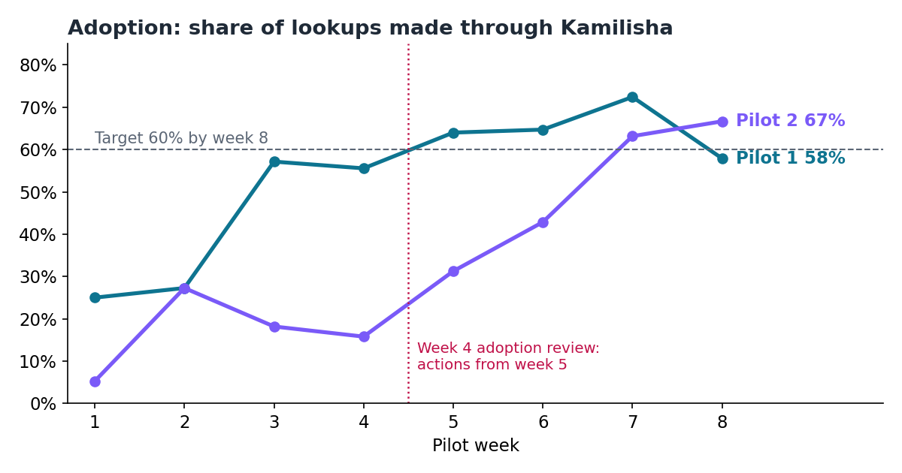
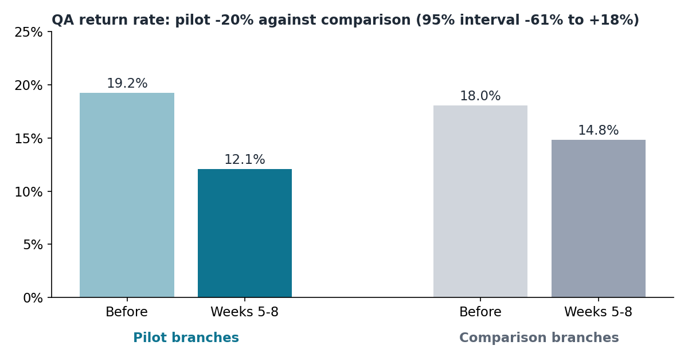
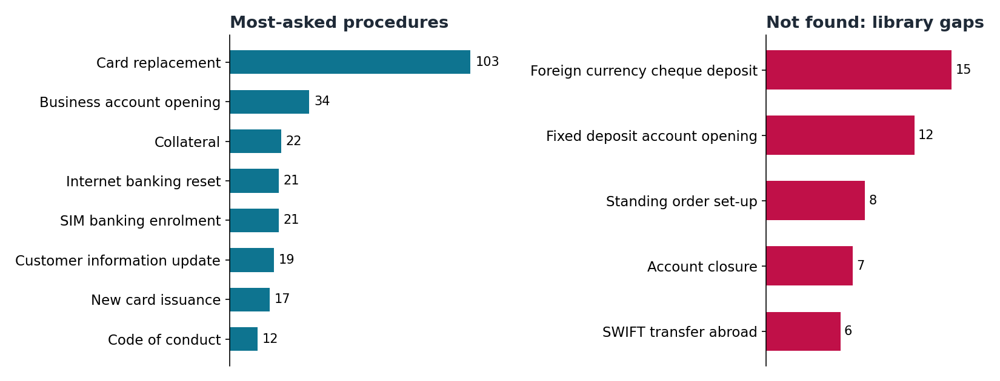

# Stage 9 — Measure

**Question:** Is Kamilisha used, is it right, and is the benefit real?

> **Simulated pilot.** The figures in this stage come from synthetic data for a fictional bank, generated by [generate_pilot_data.py](generate_pilot_data.py) with the same model as the Stage 4 baseline. They show how the pilot would be measured and reported; they are not real results.

## Summary

| | Result | Target |
| --- | --- | --- |
| Adoption, week 8 | 63% | 60% |
| Answer quality (owner review) | 96.7% | 95% |
| QA returns, pilot against comparison | -20% (95% interval -61% to +18%) | -40% |
| Staff hours released (evidence, 2 branches, 4 weeks) | 17 | Tracked |

**Decision: adjust.** Adoption and quality met their targets. The QA reduction points the right way but is not yet established: the interval is too wide after 4 weeks in 2 branches. The pilot extends 4 weeks and adds 2 pilot branches before a go decision. The forecast is updated with measured adoption, but kept apart from the evidence.

## Deliverables

| File | What it shows |
| --- | --- |
| [measure-summary.md](measure-summary.md) | Go rules, difference-in-differences for 6 KPIs with a bootstrap interval, measured value, adoption and quality, updated forecast, activity |
| [dashboard.html](dashboard.html) | Six-page dashboard: adoption, quality, benefit evidence, forecast, activity, procedure insights (open in a browser) |
| [adoption-review.md](adoption-review.md) | Week 4 review of low adoption in Pilot 2, including an unsafe workaround, actions and result |
| [opportunities-backlog.md](opportunities-backlog.md) | Seven next opportunities from the question log, triaged as in Stage 2 |
| [use-case-record.md](use-case-record.md) | Register entry, decision log and lessons learned |
| [generate_pilot_data.py](generate_pilot_data.py), [measure.py](measure.py) | Rebuild the data and every figure: `python generate_pilot_data.py` then `python measure.py` |

## Key judgements

- **Evidence, forecast and activity are reported separately.** Training attendance and licences appear only as activity.
- **The result comes with its uncertainty.** A bootstrap interval shows how sure the estimate is, so the decision is not made on noise.
- **Comparison branches mattered:** they improved too, from 18.0% to 14.8% QA returns; crediting all of the pilot's drop to Kamilisha would have overstated it.
- **Adjust is a valid outcome.** The pilot plan's rules were set before the data, and they are followed.
